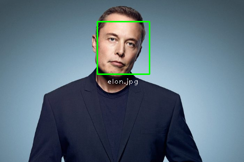
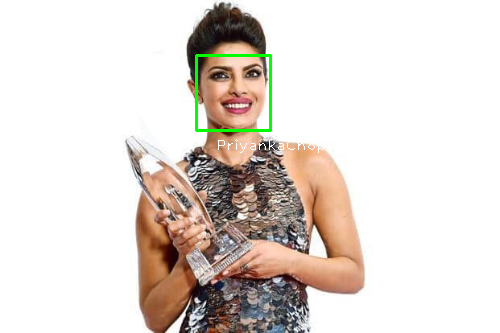
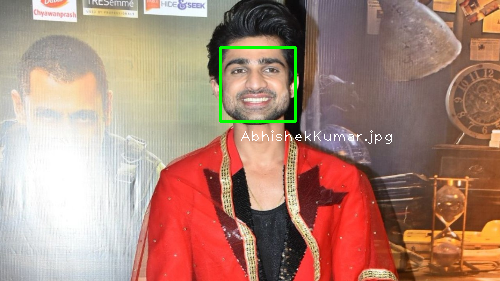
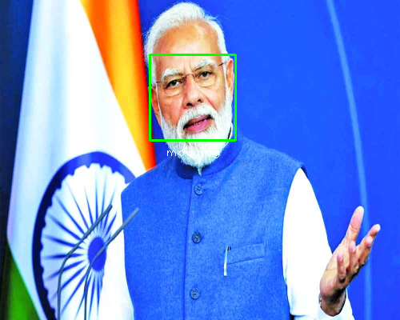
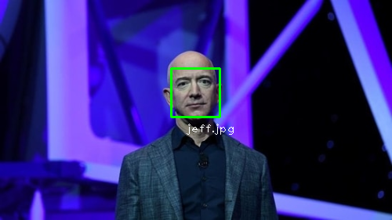

# Face Recognition using Python

A face recognition project implemented using Python, OpenCV, and the `face_recognition` library. This project demonstrates face detection, facial encoding extraction, comparison, and matching between reference and test images.

## Overview

The project uses facial encodings to compare faces present in test images against a set of reference images. It calculates face distances, identifies potential matches, and visualizes the results using bounding boxes and labels.

## Technologies Used

- Python
- OpenCV
- face_recognition
- NumPy
- Jupyter Notebook

## Project Structure

```text
Face-Recognition-Project/
│
├── images/
│   ├── reference_images/
│   ├── test_images/
│   └── README.md
│
├── outputs/
│   └── detected_faces/
│
├── src/
│   ├── __init__.py
│   ├── recognition.py
│   └── utils.py
│
├── face_recognition_demo.ipynb
├── requirements.txt
├── .gitignore
└── README.md
```

## Workflow

### 1. Image Loading and Preprocessing

Images are loaded using OpenCV. Images are resized to a consistent width while maintaining their aspect ratio to simplify processing and visualization.

### 2. Reference Face Encoding

Reference images are processed to extract facial encodings using the `face_recognition` library. These encodings represent facial features as numerical vectors and are stored for comparison.

### 3. Test Image Processing

Test images are loaded and processed to detect faces. Facial encodings are extracted from the detected faces for further comparison with the reference encodings.

### 4. Face Comparison

The `compare_faces()` function compares the facial encodings of test faces with the reference encodings and returns Boolean match results based on a tolerance threshold.

### 5. Face Distance Calculation

The `face_distance()` function calculates numerical distances between facial encodings. Lower distances indicate greater similarity between the encoding representations, but do not guarantee identity.

### 6. Face Matching

The comparison results and face distances are used to determine the closest potential match among the reference encodings. Faces that do not satisfy the matching threshold are labeled as `Unknown`.

### 7. Visualization

OpenCV is used to draw bounding boxes around detected faces and display corresponding labels. Processed images are visualized to demonstrate the recognition results.

## Results

The system processes test images, compares detected faces with reference encodings, and visualizes the results with bounding boxes and labels.

### Processed Images











## Limitations

- Recognition performance may vary with lighting conditions, image quality, facial expressions, and angles.
- Face distance and matching thresholds may result in false matches or false rejections.
- This project is a demonstration and should not be used as a reliable identity verification or security system.

## Advanced Version

An advanced version of this project is available here:

[Advanced Face Recognition](https://github.com/shruti18sk/Advanced-Face-Recognition)

## Author

Shruti Singh Kushwah
